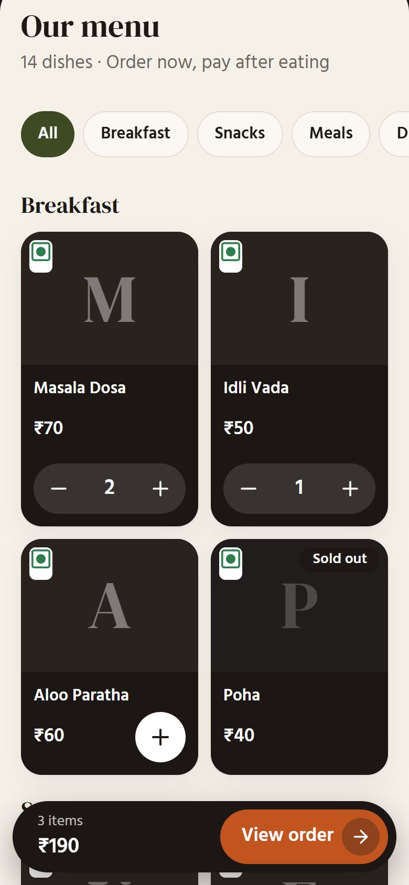
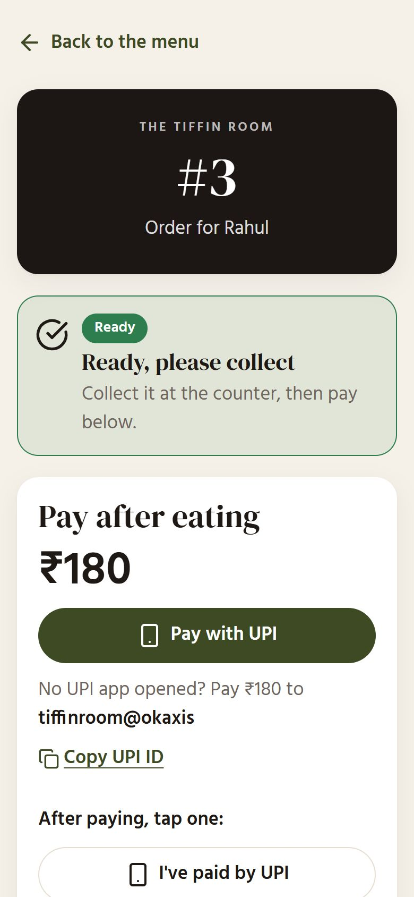
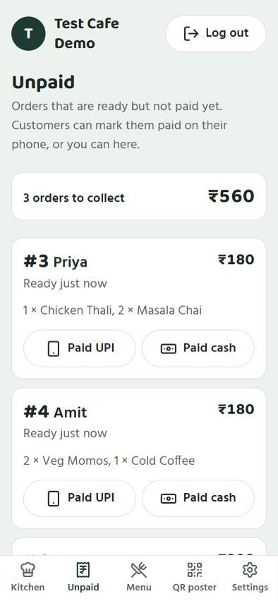
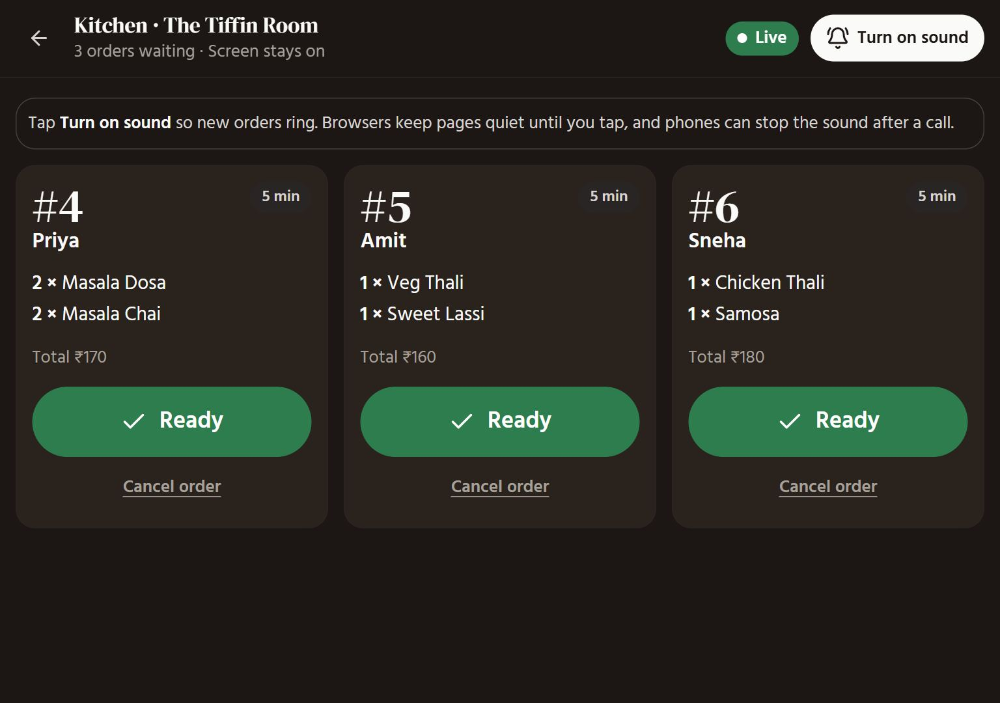
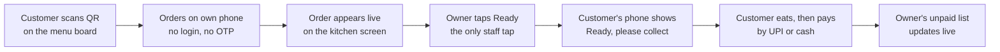
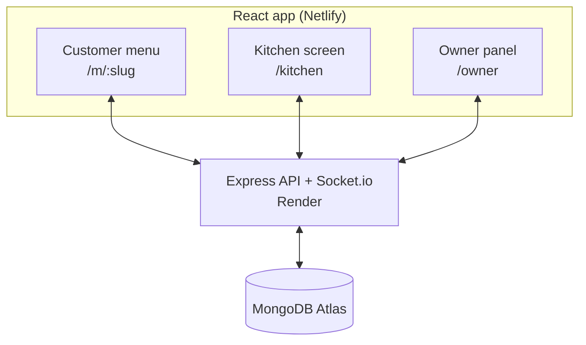

<div align="center">

# ScanServe

**QR ordering for tiny cafés: scan, order, eat, pay. No app, no login, no OTP.**


[About](#about) · [Features](#features) · [How it works](#how-it-works) · [Tech stack](#tech-stack) · [Getting started](#getting-started) · [Security](#security) · [Roadmap](#roadmap)

</div>

---

## About

In a small café with two or three people, the owner usually cooks, takes orders and keeps the accounts at the same time. Orders live in people's memory, get mixed up at rush hour, and the day's accounts are done from a notebook.

**ScanServe** fixes that without adding work. The customer scans a QR code on the menu board, orders from their own phone, and pays after eating by UPI or cash. The kitchen sees every order live and taps **Ready** once. The owner sees who has not paid yet.

It is built for real tiny cafés, starting with one in Durgapur, West Bengal.

**Live:** [scanserve-cafe.netlify.app](https://scanserve-cafe.netlify.app). Phase 1 (the MVP) is complete: café owners can create an account, build their menu and print a QR poster, and customers can open the menu from the QR (photos, categories, cart), place an order with no login, and the kitchen screen shows it live with a sound; one tap on Ready tells the customer's phone, and the customer pays after eating by UPI or cash while the owner sees an unpaid list. Tested end to end on a real phone with the printed QR. `/health` shows a setup check. The free API server sleeps when idle, so the first visit can take up to a minute.

## Features

| Feature | Phase | Status |
|---|---|---|
| Owner account and café setup (name, URL, UPI ID) | 1 | Done |
| Menu management with categories, veg tag and sold-out switch | 1 | Done |
| Printable QR poster for the menu board | 1 | Done |
| Customer menu from the QR: café cover and logo, category tabs, dish cards, cart | 1 | Done |
| Dish photos, café cover photo and logo (Cloudinary) | 1 | Done |
| Customer ordering with no login: name asked once, remembered on the phone | 1 | Done |
| Daily order numbers (1, 2, 3...) | 1 | Done |
| Live kitchen screen with one-tap **Ready** and **Cancel** | 1 | Done |
| Live order status on the customer's phone | 1 | Done |
| Pay after eating: UPI app opens with the amount filled in, or pay cash | 1 | Done |
| Owner's unpaid list, updated live | 1 | Done |
| Voice kitchen: orders read aloud, customer names called | 2 | Planned |
| Daily hisab (accounts): cash vs UPI, top dishes, charts | 3 | Planned |
| Hindi, Bengali and English, installable PWA, push notifications | 4 | Planned |
| Khata (credit) for regular customers, counter TV display | 5 | Planned |

## Screenshots

Screens from a test café: phones for customers and the owner, a tablet for the kitchen.

| Customer menu | Ready, then pay after eating | Owner: unpaid list |
|---|---|---|
|  |  |  |

**Kitchen screen:** new orders appear live with a sound; one big **Ready** button per order.



## How it works



- **Customer:** 3 taps (Order, Pay, UPI or cash). Nothing to install, no account.
- **Staff:** 1 tap per order (Ready).
- **Money:** goes straight from the customer's UPI app to the café's own UPI ID. ScanServe never touches it and uses no payment gateway.

## Tech stack

| Layer | Technology |
|---|---|
| Frontend | React 19, Vite, React Router, Tailwind CSS v4 |
| Real time | Socket.io |
| Backend | Node.js 20+, Express 5 |
| Database | MongoDB Atlas, Mongoose |
| Validation and security | zod, bcryptjs, JSON Web Tokens, helmet, express-rate-limit |
| Photos | Cloudinary (signed uploads straight from the browser) |
| Design | Baloo 2 and Hind fonts, "chalkboard and marigold" palette ([docs/Design.md](docs/Design.md)) |
| Hosting | Netlify (frontend), Render (backend) |

## Architecture



REST handles every change (place order, mark ready, mark paid); Socket.io only pushes updates to the right screens. Full details: [docs/Architecture.md](docs/Architecture.md).

## Getting started

### Prerequisites
- [Node.js](https://nodejs.org/) 20 or newer
- A free [MongoDB Atlas](https://www.mongodb.com/atlas) cluster
- Git

### 1. Clone the repository
```bash
git clone https://github.com/durgadas-karmakar07/ScanServe.git
cd ScanServe
```

### 2. Start the backend
```bash
cd server
npm install
cp .env.example .env    # then fill in the values below
npm run dev             # http://localhost:5000
```

### 3. Start the frontend (new terminal)
```bash
cd client
npm install
cp .env.example .env
npm run dev             # http://localhost:5173
```

### 4. Try it
1. Open `http://localhost:5173/owner/register` and create a café.
2. Add a few dishes in the menu editor.
3. Open `http://localhost:5173/kitchen` in the same browser (it uses your owner login) and `http://localhost:5173/m/<your-cafe-slug>` in another window, then place an order. Tap **Turn on sound** on the kitchen screen once so new orders ring.
4. Tap **Ready** on the kitchen screen; the customer page changes by itself and shows the pay panel. Unpaid orders are under **Unpaid** in the owner area.

If the API cannot reach MongoDB, check that your computer's IP address is allowed under **Network Access** in Atlas.

### Environment variables

**server/.env**

| Variable | Description |
|---|---|
| `NODE_ENV` | `development` locally, `production` on the server |
| `PORT` | API port, e.g. `5000` |
| `MONGODB_URI` | MongoDB Atlas connection string |
| `JWT_SECRET` | Long random string (at least 32 characters) |
| `CLIENT_ORIGIN` | Frontend URL allowed by CORS, e.g. `http://localhost:5173` |
| `TZ_BUSINESS` | Time zone for daily order numbers: `Asia/Kolkata` |
| `CLOUDINARY_CLOUD_NAME`, `CLOUDINARY_API_KEY`, `CLOUDINARY_API_SECRET` | Optional, all three or none: from the Cloudinary dashboard, for photo uploads |

**client/.env**

| Variable | Description |
|---|---|
| `VITE_API_URL` | Backend URL, e.g. `http://localhost:5000` |

Never commit `.env` files. Only `.env.example` (with empty values) belongs in the repository.

## Project structure

```
ScanServe/
├── client/          React frontend (customer, kitchen and owner screens)
├── server/          Express API, Socket.io, Mongoose models
└── docs/            Product, architecture, rules, phases, design and progress notes
```

## Security

Security is built in from the first phase:

- Prices and totals are always recalculated on the server; the client cannot change what a customer pays.
- Every request is validated with strict schemas; MongoDB query injection is blocked.
- Passwords are hashed with bcrypt; login is rate-limited; "Log out everywhere" revokes every login, kitchen screens included.
- Every owner query is scoped to that owner's café, and a phone can only see its own orders.
- Strict CORS, security headers and a Content-Security-Policy; no secrets in the repository.

The full rule set is in [docs/Rules.md](docs/Rules.md#5-security-rules-strict-never-break).

## Roadmap

- [x] **Phase 1, MVP:** ordering, live kitchen, pay after eating, unpaid list (done, tested on a real phone)
- [ ] **Phase 2:** voice kitchen
- [ ] **Phase 3:** daily hisab and owner tools
- [ ] **Phase 4:** Hindi, Bengali and English; PWA; push notifications
- [ ] **Phase 5:** khata, counter TV, and a one-day pilot in a real café

Details for each phase: [docs/Phases.md](docs/Phases.md).

## Documentation

| Document | What it covers |
|---|---|
| [PRD](docs/PRD.md) | What we are building, for whom, success criteria, non-goals |
| [Architecture](docs/Architecture.md) | App flow, folder structure, database schema, API, sockets |
| [Rules](docs/Rules.md) | Coding standards, security rules, product and quality rules |
| [Phases](docs/Phases.md) | Development phases and milestones |
| [Design](docs/Design.md) | Colours, typography, components, breakpoints |

## Author

**Durgadas Karmakar**, B.Tech student

- GitHub: [durgadas-karmakar07](https://github.com/durgadas-karmakar07)
- Email: [durgadask96@gmail.com](mailto:durgadask96@gmail.com)

## Acknowledgements

Inspired by the owner and staff of a small café in Durgapur, whose everyday work shaped every design decision in this project.
