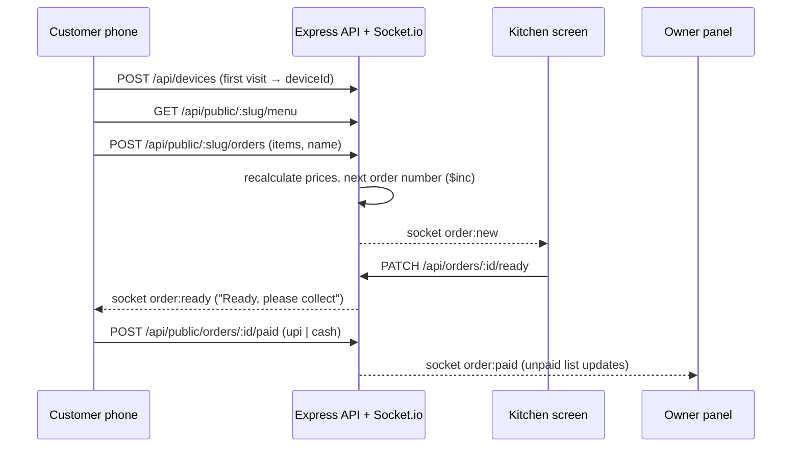

# Architecture — ScanServe

## 1. App flow



**Order status:** `new` → `ready` → `paid`. `cancelled` can happen from `new` or `ready`.
An order that is `ready` but not `paid` appears in the owner's unpaid list.

## 2. Tech stack

| Layer | Choice |
|---|---|
| Language | JavaScript (ES modules everywhere, `"type": "module"`) |
| Frontend | React 19 + Vite, React Router, Tailwind CSS v4 (`@tailwindcss/vite`), `socket.io-client`, `lucide-react` icons, `qrcode` |
| Backend | Node.js 20+, Express 5, Mongoose, Socket.io, `zod`, `jsonwebtoken`, `bcryptjs`, `helmet`, `cors`, `express-rate-limit`, `dotenv` |
| Database | MongoDB Atlas (free tier) |
| Hosting | Frontend on Netlify, backend on Render (keeps a server running for Socket.io) |
| Dev tools | `nodemon` (server), ESLint + Prettier, optional Vitest + Supertest |

## 3. Folder structure

```
scanserve/
├── netlify.toml               # Netlify build (client/), API URL, security headers
├── docs/                      # these 6 files
├── client/
│   ├── index.html
│   ├── vite.config.js
│   ├── .env.example           # VITE_API_URL
│   └── src/
│       ├── main.jsx
│       ├── App.jsx            # routes
│       ├── index.css          # Tailwind import + @theme tokens (see Design.md)
│       ├── api/               # client.js (fetch wrapper), auth.js, health.js, menu.js, orders.js
│       ├── components/        # RequireAuth.jsx (guards owner routes)
│       ├── components/ui/     # Button, Card, Badge, Input, Alert, Sheet, Toast
│       ├── context/           # authContext.js + AuthProvider.jsx, CartContext.jsx
│       ├── hooks/             # useAuth.js, useDevice.js, useSocket.js
│       ├── lib/               # format.js (₹), upi.js (UPI link), slug.js, tokenStorage.js
│       └── features/
│           ├── common/        # NotFoundPage
│           ├── health/        # HealthPage (setup check, step 1.1)
│           ├── customer/      # MenuPage, CartBar, OrderStatusPage, PayPanel
│           ├── kitchen/       # KitchenPage, OrderCard
│           └── owner/         # AuthLayout, RegisterPage, LoginPage, DashboardPage,
│                              # MenuEditor, UnpaidList, QrPoster, SettingsPage
└── server/
    ├── .env.example
    └── src/
        ├── server.js          # http server + Socket.io start
        ├── app.js             # express app, middleware, routes
        ├── config/            # env.js (validated env), db.js
        ├── models/            # Restaurant, Staff, MenuItem, Device, Order, DailyCounter
        ├── routes/            # health, auth, public, menu, orders, restaurant (*.routes.js)
        ├── controllers/       # one file per route group
        ├── services/          # auth.service.js, order.service.js, counter.service.js
        ├── middleware/        # requireAuth.js, requireDevice.js, validate.js, errorHandler.js,
        │                      # rateLimit.js (apiLimiter, authLimiter)
        ├── validators/        # zod schemas: common.js, auth.validators.js, ...
        ├── socket/            # index.js (auth, rooms), emit.js (helpers)
        └── utils/             # AppError.js, token.js (sign / verify JWT)
```

## 4. Client routes

| Route | Screen | Who |
|---|---|---|
| `/` | Redirects to `/owner` (which sends logged-out visitors to `/owner/login`) | Anyone |
| `/health` | Setup check: can the app reach the API? | Anyone |
| `/m/:slug` | Menu + cart | Customer |
| `/m/:slug/order/:orderId` | Order status + pay | Customer |
| `/owner/register`, `/owner/login` | Create café / log in | Owner |
| `/owner` | Dashboard: unpaid list, menu editor, QR poster, settings | Owner |
| `/kitchen` | Live kitchen board | Owner / cook (logged in on the kitchen device) |

## 5. Database schema (MongoDB, Mongoose)

```js
Restaurant  { name, slug (unique), upiId, isAcceptingOrders: true, createdAt }
Staff       { restaurantId, name, email (unique), passwordHash (select: false), role: 'owner', tokenVersion: 0 }
MenuItem    { restaurantId, name, category, price (integer ₹), isVeg, available: true, sortOrder }
Device      { deviceId (unique, UUID), name, firstSeenAt, lastSeenAt }
Order       {
  restaurantId, deviceId, customerName, orderNumber, businessDate: 'YYYY-MM-DD',
  items: [{ menuItemId, name, price, qty }],   // name + price COPIED at order time
  total,                                        // calculated by the server
  status: 'new' | 'ready' | 'paid' | 'cancelled',
  paymentMethod: null | 'upi' | 'cash',
  paidMarkedBy: null | 'customer' | 'owner',
  createdAt, readyAt, paidAt, cancelledAt
}
DailyCounter { restaurantId, date: 'YYYY-MM-DD', lastNumber }   // unique (restaurantId, date)
```

**Indexes:** `Restaurant.slug` unique, `Staff.email` unique, `Staff.restaurantId`, `Device.deviceId` unique, `DailyCounter (restaurantId, date)` unique, `Order (restaurantId, status)`, `Order (deviceId, createdAt)`.

**Order number:** `DailyCounter.findOneAndUpdate({ restaurantId, date }, { $inc: { lastNumber: 1 } }, { upsert: true, new: true })`. Business date uses the `Asia/Kolkata` time zone.

## 6. REST API

All responses are JSON. Errors: `{ "error": { "code": "ORDER_NOT_FOUND", "message": "..." } }`. Form errors add `fields`, one message per field: `{ "error": { "code": "VALIDATION_ERROR", "message": "Please check the highlighted fields.", "fields": { "upiId": "Enter a valid UPI ID, e.g. royalcafe@okaxis" } } }`.

**Auth endpoints (step 1.2)**

| Endpoint | Body | Success | Errors |
|---|---|---|---|
| `POST /api/auth/register` | `{ restaurantName, slug, upiId, ownerName, email, password }` | `201 { token, staff, restaurant }` | `400 VALIDATION_ERROR`, `400 INVALID_CREDENTIALS` (email taken: same message as a wrong password), `409 SLUG_TAKEN`, `429 RATE_LIMITED` |
| `POST /api/auth/login` | `{ email, password }` | `200 { token, staff, restaurant }` | `400 VALIDATION_ERROR`, `401 INVALID_CREDENTIALS`, `429 RATE_LIMITED` |
| `GET /api/auth/me` | — (`Authorization: Bearer <token>`) | `200 { staff, restaurant }` | `401 UNAUTHORIZED` |

`staff` = `{ id, name, email, role }`; `restaurant` = `{ id, name, slug, upiId, isAcceptingOrders }`. Password hashes and `tokenVersion` never leave the server. Rate limits on these routes: 5 failed attempts per IP + email and 30 failed attempts per IP per 15 minutes (login and register together), and 5 successful sign-ups per IP per hour.

| Method | Path | Auth | Purpose |
|---|---|---|---|
| GET | `/api/health` | — | Health check → `{ ok: true }` |
| POST | `/api/auth/register` | — (rate-limited) | Create restaurant + owner, return JWT |
| POST | `/api/auth/login` | — (rate-limited) | Email + password → JWT |
| GET | `/api/auth/me` | Owner | Current owner + restaurant |
| PATCH | `/api/restaurant` | Owner | Name, UPI ID, accepting orders on/off |
| GET, POST | `/api/menu` | Owner | List / add dishes |
| PATCH, DELETE | `/api/menu/:id` | Owner | Edit / delete, sold-out switch |
| GET | `/api/orders?status=new,ready` | Owner | Kitchen board orders |
| GET | `/api/orders/unpaid` | Owner | Today's ready-but-unpaid orders |
| PATCH | `/api/orders/:id/ready` | Owner | The one kitchen tap |
| PATCH | `/api/orders/:id/cancel` | Owner | Cancel |
| PATCH | `/api/orders/:id/mark-paid` | Owner | Owner marks paid (`upi` / `cash`) |
| POST | `/api/devices` | — | Create or confirm a device ID |
| GET | `/api/public/:slug/menu` | — | Restaurant info + available dishes |
| POST | `/api/public/:slug/orders` | Device | Place order: `{ customerName, items: [{ menuItemId, qty }] }` |
| GET | `/api/public/orders/:id` | Device (must own it) | Order status |
| POST | `/api/public/orders/:id/paid` | Device (must own it) | Customer marks paid: `{ method }` |

- **Owner auth:** `Authorization: Bearer <JWT>` (7-day expiry; payload `staffId`, `restaurantId`, `role`, `tokenVersion`). Full security rules: `Rules.md` section 5.
- **Device auth:** header `X-Device-Id: <uuid>`; the server checks the device exists and owns the order.
- **Order rules:** server recalculates every price from `MenuItem`; rejects unavailable dishes; max 2 open (`new` or `ready`, unpaid) orders per device; max 20 of one dish per order.

## 7. Socket.io

| Room | Who joins | How |
|---|---|---|
| `kitchen:<restaurantId>` | Kitchen screen and owner panel | Handshake `auth: { token }` (JWT verified) |
| `device:<deviceId>` | Customer phone | Handshake `auth: { deviceId }` |

| Event | Sent to | Payload |
|---|---|---|
| `order:new` | kitchen room | full order |
| `order:ready` | kitchen room + device room | `{ orderId, orderNumber }` |
| `order:cancelled` | kitchen room + device room | `{ orderId }` |
| `order:paid` | kitchen room + device room | `{ orderId, paymentMethod, paidMarkedBy }` |
| `menu:updated` | (Phase 2+) | — |

The server assigns rooms from the verified JWT or device ID; clients cannot pick a room. Clients never change data over sockets. On reconnect, clients refetch their data over REST; sockets only notify.

## 8. Third-party services

| Service | Used for | Phase |
|---|---|---|
| MongoDB Atlas | Database | 1 |
| Netlify | Frontend hosting (config in `netlify.toml`) | 1 |
| Render | Backend + Socket.io hosting | 1 |
| UPI deep link (`upi://pay?pa=&pn=&am=&cu=INR&tn=`) | Opens the customer's UPI app; not an API, no keys, no fees | 1 |
| Web Speech API (`speechSynthesis`) | Voice in the kitchen (built into browsers) | 2 |
| Cloudinary | Dish photos | 3 |
| Web Push (`web-push`) | "Food is ready" notifications | 4 |

No payment gateway. Money goes straight from the customer's UPI app to the café's UPI ID.

## 9. Environment variables

```
# server/.env
NODE_ENV=development   # production on Render (turns on trust proxy)
PORT=5000
MONGODB_URI=
JWT_SECRET=            # long random string
CLIENT_ORIGIN=http://localhost:5173
TZ_BUSINESS=Asia/Kolkata

# client/.env
VITE_API_URL=http://localhost:5000
```

**Production:** the server variables are set in the Render dashboard (`NODE_ENV=production`, `CLIENT_ORIGIN` = the Netlify URL, `MONGODB_URI` for the `scanserve-prod` user and the `scanserve_prod` database, its own `JWT_SECRET`). `VITE_API_URL` for the live site is in `netlify.toml` (public value). Atlas allows only the home IP and Render's Singapore outbound ranges.

| Service | URL |
|---|---|
| API (Render, Singapore, free) | `https://scanserve-api-xuy5.onrender.com` |
| Web app (Netlify, public) | `https://scanserve-cafe.netlify.app` |
