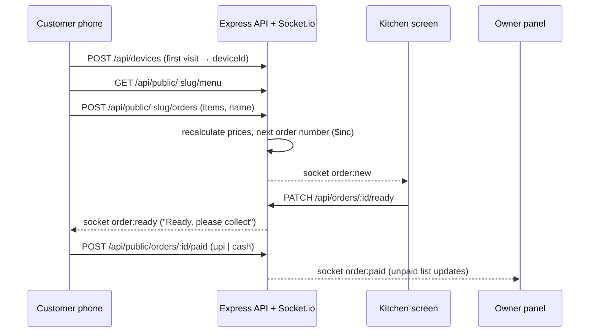

# Architecture — ScanServe

## 1. App flow



**Order status:** `new` → `ready` → `paid`. `cancelled` can happen from `new` or `ready`.
An order that is `ready` but not `paid` appears in the owner's unpaid list.

## 2. Tech stack

| Layer | Choice |
|---|---|
| Language | JavaScript (ES modules everywhere, `"type": "module"`) |
| Frontend | React 19 + Vite, React Router, Tailwind CSS v4 (`@tailwindcss/vite`), `socket.io-client`, `lucide-react` icons, `qrcode`, fonts DM Serif Display + Hind via `@fontsource` |
| Backend | Node.js 20+, Express 5, Mongoose, Socket.io, `zod`, `jsonwebtoken`, `bcryptjs`, `helmet`, `cors`, `express-rate-limit`, `dotenv`; photos on Cloudinary (signed browser uploads, no SDK) |
| Database | MongoDB Atlas (free tier) |
| Hosting | Frontend on Netlify, backend on Render (keeps a server running for Socket.io) |
| Dev tools | `nodemon` (server), ESLint + Prettier, optional Vitest + Supertest |

## 3. Folder structure

```
scanserve/
├── netlify.toml               # Netlify build (client/), API URL, security headers
├── docs/                      # these 6 files
├── client/
│   ├── index.html
│   ├── vite.config.js
│   ├── .env.example           # VITE_API_URL
│   └── src/
│       ├── main.jsx
│       ├── App.jsx            # routes
│       ├── index.css          # Tailwind import + @theme tokens (see Design.md)
│       ├── api/               # client.js (fetch wrapper; token or X-Device-Id), auth.js,
│       │                      # health.js, menu.js, restaurant.js, uploads.js, public.js,
│       │                      # devices.js, orders.js
│       ├── components/        # RequireAuth.jsx (guards owner routes), Wordmark, DishPhoto
│       ├── components/ui/     # Button, LinkButton, Card, Badge, Input, Alert, Switch, VegMark,
│       │                      # Sheet, PhotoPicker, QuantityStepper
│       ├── context/           # authContext.js + AuthProvider.jsx, toastContext.js +
│       │                      # ToastProvider.jsx (the toast), cartContext.js + CartProvider.jsx
│       ├── hooks/             # useAuth.js, useToast.js, useFocusFirstError.js, useDevice.js,
│       │                      # useCart.js, useModalDialog.js (native <dialog>), useSocket.js, useWakeLock.js
│       ├── lib/               # format.js (₹), upi.js (UPI link), slug.js, tokenStorage.js,
│       │                      # cartStorage.js, menu.js (group by category), deviceStorage.js,
│       │                      # keyRepeatGuard.js, orderSound.js (Web Audio chime), upi.js
│       └── features/
│           ├── common/        # NotFoundPage
│           ├── health/        # HealthPage (setup check, step 1.1)
│           ├── customer/      # MenuPage, CustomerMenu, MenuHero, CategoryChips, DishCard,
│           │                  # DishDetail, OrderSummary, NameStep, CartBar, OrderStatusPage, PayPanel
│           ├── kitchen/       # KitchenPage (live board, sound, screen kept on), OrderCard
│           └── owner/         # AuthLayout, RegisterPage, LoginPage, OwnerLayout (night sidebar
│               │              # on desktop, tabs on phones), OverviewPage, QrPoster,
│               │              # SettingsPage, BrandingCard, UnpaidPage
│               └── menu/      # MenuEditor, MenuItemRow, DishSheet, DeleteDishSheet
└── server/
    ├── .env.example
    └── src/
        ├── server.js          # http server + Socket.io start
        ├── app.js             # express app, middleware, routes
        ├── config/            # env.js (validated env), db.js
        ├── models/            # Restaurant, Staff, MenuItem, photoSchema, RateLimitCounter,
        │                      # Device, Order, DailyCounter
        ├── routes/            # health, auth, devices, public (menu + customer orders), menu,
        │                      # uploads, orders (kitchen, step 1.6), restaurant
        ├── controllers/       # one file per route group
        ├── services/          # auth.service.js, photo.service.js, order.service.js,
        │                      # counter.service.js
        ├── middleware/        # requireAuth.js, requireDevice.js, validate.js, errorHandler.js,
        │                      # rateLimit.js (API, auth, device, order and photo limiters),
        │                      # mongoRateLimitStore.js (limits that survive restarts)
        ├── validators/        # zod schemas: common.js (ids, names, UPI ID), auth, menu,
        │                      # restaurant, upload, public, device, order (*.validators.js)
        ├── socket/            # index.js (handshake auth, server-chosen rooms), emit.js (emitToKitchen, emitToDevice)
        └── utils/             # AppError.js, token.js (sign / verify JWT), cloudinary.js
```

## 4. Client routes

| Route | Screen | Who |
|---|---|---|
| `/` | Redirects to `/owner` (which sends logged-out visitors to `/owner/login`) | Anyone |
| `/health` | Setup check: can the app reach the API? | Anyone |
| `/m/:slug` | Menu + cart | Customer |
| `/m/:slug/order/:orderId` | Order status + pay | Customer |
| `/owner/register`, `/owner/login` | Create café / log in | Owner |
| `/owner` | Owner area (sidebar on desktop, tabs on phones); redirects to `/owner/overview` | Owner |
| `/owner/overview` | Dashboard: today's orders and money, unpaid and kitchen counts, live order queue, menu cards with the sold-out switch | Owner |
| `/owner/menu` | Menu editor: add, edit, delete dishes, sold-out switch | Owner |
| `/owner/qr` | Printable QR poster for `<site>/m/<slug>` | Owner |
| `/owner/settings` | Café name, UPI ID, taking orders on/off | Owner |
| `/owner/unpaid` | Unpaid list: ready orders not paid yet, live, with Paid UPI / Paid cash | Owner |
| `/kitchen` | Live kitchen board | Owner / cook (logged in on the kitchen device) |

## 5. Database schema (MongoDB, Mongoose)

```js
Restaurant  { name, slug (unique), tagline, upiId, isAcceptingOrders: true, coverPhoto, logo, createdAt }
Staff       { restaurantId, name, email (unique), passwordHash (select: false), role: 'owner', tokenVersion: 0 }
MenuItem    { restaurantId, name, description, category, price (integer ₹ 1–99999), isVeg, isAvailable: true, photo, sortOrder, createdAt, updatedAt }
Photo       { publicId, version }   // Cloudinary id in scanserve/<NODE_ENV>/<restaurantId>/<dish|cover|logo>/; URLs are built when sending
Device      { deviceId (unique, UUID v4 made by the server), name, firstSeenAt, lastSeenAt, orderLockUntil (internal) }
Order       {
  restaurantId, deviceId, customerName, orderNumber, businessDate: 'YYYY-MM-DD',
  items: [{ menuItemId, name, price, qty }],   // name + price COPIED at order time
  total,                                        // calculated by the server
  status: 'new' | 'ready' | 'paid' | 'cancelled',
  paymentMethod: null | 'upi' | 'cash',
  paidMarkedBy: null | 'customer' | 'owner',
  createdAt, readyAt, paidAt, cancelledAt
}
DailyCounter { restaurantId, date: 'YYYY-MM-DD', lastNumber }   // unique (restaurantId, date)
RateLimitCounter { _id: '<limit prefix><key>', hits, expiresAt }   // daily upload limits; TTL deletes it
```

**Indexes:** `Restaurant.slug` unique, `Staff.email` unique, `Staff.restaurantId`, `MenuItem (restaurantId, sortOrder)`, `Device.deviceId` unique, `DailyCounter (restaurantId, date)` unique, `Order (restaurantId, status)`, `Order (deviceId, createdAt)`, `RateLimitCounter.expiresAt` TTL (expire at that time).

**Order number:** `DailyCounter.findOneAndUpdate({ restaurantId, date }, { $inc: { lastNumber: 1 } }, { upsert: true, new: true })`. Business date uses the `Asia/Kolkata` time zone.

## 6. REST API

All responses are JSON. Errors: `{ "error": { "code": "ORDER_NOT_FOUND", "message": "..." } }`. Form errors add `fields`, one message per field: `{ "error": { "code": "VALIDATION_ERROR", "message": "Please check the highlighted fields.", "fields": { "upiId": "Enter a valid UPI ID, e.g. royalcafe@okaxis" } } }`.

**Auth endpoints (step 1.2)**

| Endpoint | Body | Success | Errors |
|---|---|---|---|
| `POST /api/auth/register` | `{ restaurantName, slug, upiId, ownerName, email, password }` | `201 { token, staff, restaurant }` | `400 VALIDATION_ERROR`, `400 INVALID_CREDENTIALS` (email taken: same message as a wrong password), `409 SLUG_TAKEN`, `429 RATE_LIMITED` |
| `POST /api/auth/login` | `{ email, password }` | `200 { token, staff, restaurant }` | `400 VALIDATION_ERROR`, `401 INVALID_CREDENTIALS`, `429 RATE_LIMITED` |
| `GET /api/auth/me` | — (`Authorization: Bearer <token>`) | `200 { staff, restaurant }` | `401 UNAUTHORIZED` |

`staff` = `{ id, name, email, role }`; `restaurant` = `{ id, name, slug, upiId, isAcceptingOrders }`. Password hashes and `tokenVersion` never leave the server. Rate limits on these routes: 5 failed attempts per IP + email and 30 failed attempts per IP per 15 minutes (login and register together), and 5 successful sign-ups per IP per hour.

**Menu and café settings (step 1.3)**: all need the owner token; every query uses the `restaurantId` from the token, so another café's dish id gives `404`.

| Endpoint | Body | Success | Errors |
|---|---|---|---|
| `GET /api/menu` | — | `200 { items }` sorted by `sortOrder` | `401` |
| `POST /api/menu` | `{ name, description?, category, price, isVeg, isAvailable?, photo? }` | `201 { item }` (server sets `sortOrder`) | `400 VALIDATION_ERROR`, `409 MENU_FULL` (200 dishes) |
| `PATCH /api/menu/:id` | any of `{ name, description, category, price, isVeg, isAvailable, photo }` (`photo: null` removes it) | `200 { item }` | `400`, `404 MENU_ITEM_NOT_FOUND` |
| `DELETE /api/menu/:id` | — | `204` | `400`, `404 MENU_ITEM_NOT_FOUND` |
| `PATCH /api/restaurant` | any of `{ name, tagline, upiId, isAcceptingOrders, coverPhoto, logo }` (the slug cannot change) | `200 { restaurant }` | `400` |

`item` = `{ id, name, description, category, price, isVeg, isAvailable, photoUrl, sortOrder }`; the owner `restaurant` also has `tagline`, `coverUrl`, `logoUrl`. Names, descriptions and categories are trimmed with repeated spaces collapsed; price is a whole number of rupees. A `photo` is `{ publicId, version }` from the upload and must be in the café's own folder for that kind, else `400` with `fields.photo` / `fields.coverPhoto` / `fields.logo`. A replaced or removed photo is deleted from Cloudinary in the background.

**Photos and the customer menu (redesign, 2026-11-23)**

| Endpoint | Auth | Body | Success | Errors |
|---|---|---|---|---|
| `POST /api/uploads/signature` | Owner | `{ kind: 'dish' | 'cover' | 'logo' }` | `200 { cloudName, apiKey, signature, params }`; the browser posts the file with these to `https://api.cloudinary.com/v1_1/<cloud>/image/upload` | `400`, `401`, `429 RATE_LIMITED` (per café 60 an hour and 100 a day, per network 120 a day, 300 a day across all cafés; only signatures given out count; the daily counts live in MongoDB so a sleeping or restarted server does not reset them), `503 PHOTOS_NOT_CONFIGURED` |
| `GET /api/public/:slug/menu` | — | — | `200 { restaurant: { name, slug, tagline, isAcceptingOrders, coverUrl, logoUrl }, items: [{ id, name, description, category, price, isVeg, isAvailable, photoUrl }] }` (sold-out dishes included; no UPI ID, no internal ids) | `400` bad slug, `404 RESTAURANT_NOT_FOUND` |

**Review fixes (Phase 1 completion, 2026-11-24)**

- `POST /api/public/:slug/orders` takes an optional `checkoutId` (UUID v4, made per checkout by the web app and renewed when the cart changes). The same id again answers `200` with the order already saved (partial unique index on `{ deviceId, checkoutId }`), so a lost answer and a second tap never make a duplicate order. The 2-open-orders limit counts per café.
- `GET /api/public/:slug/orders/mine` (device) lists this phone's open orders at the café, newest first; the menu shows a link to each (no order history is kept in the browser any more).
- `GET /api/orders` also takes `order=oldest|newest` (default oldest) and returns `{ orders, count, amount, hasMore }`: at most 200 orders, while `count` and `amount` (sum of totals) cover all matching orders. The kitchen and unpaid screens warn when `hasMore`. The unpaid list asks for `status=ready&order=newest`.
- The kitchen's `PATCH /api/orders/:id/cancel` works only on `new` orders (`changeOrderStatus` `onlyFrom`), so a Cancel from a stale screen cannot undo a Ready; the cancel sheet also closes when its order leaves the board.
- Socket handshake errors: `UNAUTHORIZED` for a bad or revoked token or an unknown device (the web app then reloads over REST, and a 401 logs the owner out), `RETRY` for anything else (the web app retries with backoff, also after the server ends a connection).
- `POST /api/auth/logout-all` ("Log out everywhere" in Settings) increments `tokenVersion`, so every older token fails on its next request, and disconnects the café's kitchen sockets so they must log in again.

**Pay after eating (step 1.7, 2026-11-24)**

| Endpoint | Auth | Body | Success | Errors |
|---|---|---|---|---|
| `POST /api/public/orders/:id/paid` | Device (must own it) | `{ method: 'upi' | 'cash' }` (no amount: it is always the order total) | `200 { order, restaurant }` with `status: 'paid'`, `paymentMethod`; repeating is harmless | `400`, `401`, `404 ORDER_NOT_FOUND` (also another phone's order), `409 INVALID_STATUS_CHANGE` ("is not ready yet", "was cancelled") |
| `PATCH /api/orders/:id/mark-paid` | Owner | `{ method: 'upi' | 'cash' }` | `200 { order }` (`paidMarkedBy: 'owner'`) | same as above |

Paying is allowed only from `ready` (`new → ready → paid`; a paid order cannot be cancelled), through the same `changeOrderStatus` function with `scope: { deviceId }` for the phone and `{ restaurantId }` for the owner. Both emit `order:paid { orderId, paymentMethod, paidMarkedBy }` to the café's kitchen room and the phone. The customer's order responses now include the café's `upiId` (the public menu still does not). The pay panel builds `upi://pay?pa=<UPI ID>&pn=<café>&am=<total>.00&cu=INR&tn=Order <n>` with `URLSearchParams` (spaces as `%20`, `@` kept), shows "Pay ₹X to <UPI ID>" with a copy button as the fallback, and has separate "I've paid by UPI" and "Paying cash" taps, so an order is not marked paid if the UPI app is closed without paying. The unpaid list uses `GET /api/orders?status=ready` and updates live on `order:ready` (reload), `order:paid` and `order:cancelled` (remove).

**Owner dashboard (premium redesign, 2026-11-24)**

| Endpoint | Auth | Body | Success | Errors |
|---|---|---|---|---|
| `GET /api/orders/summary` | Owner | — | `200 { businessDate, today: { orders, cancelled, paidAmount, cashAmount, upiAmount }, open: { newCount, readyCount, unpaidAmount } }` | `401` |

`today` covers orders of the current business day (`Asia/Kolkata`) at the token's café: `orders` leaves out cancelled ones, and the amounts add up the totals of today's orders that are `paid`, split by method. `open` covers every unpaid open order whatever its day: `newCount` is the kitchen's queue, `readyCount` and `unpaidAmount` are the unpaid list. It runs two aggregations; the `restaurantId` is cast to an `ObjectId` by hand because Mongoose does not cast aggregation pipelines. The owner layout loads it on every page change and again on each `order:*` socket event, and shows `newCount` / `readyCount` as live badges on Kitchen and Unpaid; the Overview page also loads the open queue with `GET /api/orders?status=new,ready`.

**Live kitchen (step 1.6, 2026-11-24)**

| Endpoint | Auth | Body | Success | Errors |
|---|---|---|---|---|
| `GET /api/orders?status=new` | Owner | — (`status` is a comma list of `new`, `ready`, `paid`, `cancelled`; default `new`) | `200 { orders }` oldest first, at most 100, only the token's café | `400`, `401` |
| `PATCH /api/orders/:id/ready` | Owner | — | `200 { order }`; repeating it returns the same order (double tap is harmless) | `400`, `401`, `404 ORDER_NOT_FOUND` (also another café's order), `409 INVALID_STATUS_CHANGE` |
| `PATCH /api/orders/:id/cancel` | Owner | — | `200 { order }` (from `new` or `ready`; repeating is harmless) | same as above |

Kitchen `order` = `{ id, orderNumber, customerName, items: [{ name, price, qty }], total, status, createdAt, readyAt, cancelledAt }`. Every status change goes through `changeOrderStatus` in `order.service.js`: one atomic update that matches only the allowed starting statuses (`new → ready`, `new|ready → cancelled`), so Ready and Cancel tapped at the same moment cannot both apply out of order. Socket.io runs on the same port as the API (path `/socket.io`, outside the `/api` rate limiter); the handshake needs `auth: { token }` (checked like `requireAuth`, including `tokenVersion`) or `auth: { deviceId }` (must exist), otherwise it is refused with `UNAUTHORIZED`. There are no client events. The kitchen board and the order status page refetch over REST on every connect and reconnect. The web app's CSP allows `wss://` to the API. Measured locally: a new order reaches the kitchen in about 0.4 s.

**Devices and orders (steps 1.4 and 1.5, 2026-11-24)**

| Endpoint | Auth | Body | Success | Errors |
|---|---|---|---|---|
| `POST /api/devices` | — (100 new devices per 15 min per IP; confirmations not counted) | `{ deviceId? }` (UUID v4) | known id: `200 { device: { deviceId, name } }`; no id or an unknown id: `201` with a **new server-made** id (a phone can never choose its id) | `400`, `429` |
| `POST /api/public/:slug/orders` | Device (`X-Device-Id`); 10 a minute per IP and per device | `{ customerName (1–30 chars, any script, no control characters; "Guest" when skipped), items: [{ menuItemId, qty (1–20) }] }` (1–30 lines, each dish once, no other fields: prices and totals from the client are refused) | `201 { order, restaurant: { name, slug, logoUrl } }` | `400`, `401 DEVICE_REQUIRED` / `DEVICE_UNKNOWN`, `404 RESTAURANT_NOT_FOUND`, `409 NOT_ACCEPTING_ORDERS`, `409 TOO_MANY_OPEN_ORDERS` (2 open), `409 MENU_CHANGED` (dish gone or from another café), `409 ITEM_UNAVAILABLE` (names the sold-out dishes), `409 ORDER_IN_PROGRESS` (double tap), `429` |
| `GET /api/public/orders/:id` | Device (must own it) | — | `200 { order, restaurant }` | `400`, `401`, `404 ORDER_NOT_FOUND` (also for someone else's order) |

`order` = `{ id, orderNumber, customerName, items: [{ name, price, qty }], total, status, paymentMethod, createdAt, readyAt, paidAt, cancelledAt }` (no restaurant, device or menu item ids). Placing an order takes a 10-second lock on the device (`Device.orderLockUntil`), so a double tap or two tabs create one order and cannot get past the 2-open-orders limit; the request releases only its own lock. The order number comes from `DailyCounter` (one atomic `$inc` per order, business day in `Asia/Kolkata`) and a unique index on `(restaurantId, businessDate, orderNumber)`; a number may be skipped if saving then fails. The web app registers a device only when the phone places its first order (viewing the menu sends nothing), keeps `deviceId` and the first name in `localStorage` (open orders come from `/orders/mine`), and retries once with a new device if the saved one is unknown. Until sockets arrive (step 1.6) the order status page checks again when the customer returns to it or taps Check status.

Each signature is for exactly one photo. It covers `allowed_formats=jpg,jpeg,png,webp`, `overwrite=false`, `public_id=scanserve/<NODE_ENV>/<restaurantId>/<kind>/<random UUID>` (the server picks the id, so a reused signature can only send the same photo again), `timestamp` and `transformation=c_limit,w_1600,h_1600,q_auto:good,f_webp` (on arrival every photo is shrunk to at most 1600px, compressed and stored as WebP, which keeps logo transparency; Cloudinary may keep a gray-only photo as JPG). The signature cannot fix which Cloudinary endpoint is used (image, video, raw, auto are in the URL, not signed), so the signed `allowed_formats` is what refuses other file types everywhere; there is deliberately no `format` param, because with it Cloudinary converts other types instead of refusing them. Checked with real uploads: text files are refused on the raw and auto endpoints, even when named `.jpg`; a reused signature returns the existing photo (`existing=true`) and cannot overwrite it. The web app accepts only JPG, PNG and WebP up to 5 MB. Delivery URLs use `f_auto,q_auto` and one size per kind (dish 640×480, cover 1600×700, logo 256×256), which keeps bandwidth low on the free plan (25 credits a month; 1 credit = 1 GB stored or 1 GB delivered or 1,000 transformations).

| Method | Path | Auth | Purpose |
|---|---|---|---|
| GET | `/api/health` | — | Health check → `{ ok: true }` |
| POST | `/api/auth/register` | — (rate-limited) | Create restaurant + owner, return JWT |
| POST | `/api/auth/login` | — (rate-limited) | Email + password → JWT |
| GET | `/api/auth/me` | Owner | Current owner + restaurant |
| PATCH | `/api/restaurant` | Owner | Name, UPI ID, accepting orders on/off |
| GET, POST | `/api/menu` | Owner | List / add dishes |
| PATCH, DELETE | `/api/menu/:id` | Owner | Edit / delete, sold-out switch |
| GET | `/api/orders?status=new,ready` | Owner | Kitchen board orders |
| GET | `/api/orders?status=ready` | Owner | Unpaid list: ready orders not paid yet (any day, oldest first) |
| GET | `/api/orders/summary` | Owner | Dashboard numbers: today's orders and money, open counts |
| PATCH | `/api/orders/:id/ready` | Owner | The one kitchen tap |
| PATCH | `/api/orders/:id/cancel` | Owner | Cancel |
| PATCH | `/api/orders/:id/mark-paid` | Owner | Owner marks paid (`upi` / `cash`) |
| POST | `/api/auth/logout-all` | Owner | Log out everywhere: raises `tokenVersion`, cuts the café's kitchen sockets |
| POST | `/api/devices` | — | Create or confirm a device ID |
| GET | `/api/public/:slug/menu` | — | Restaurant info + available dishes |
| POST | `/api/public/:slug/orders` | Device | Place order: `{ customerName, items: [{ menuItemId, qty }] }` |
| GET | `/api/public/:slug/orders/mine` | Device | This phone's open orders at the café (links on the menu) |
| GET | `/api/public/orders/:id` | Device (must own it) | Order status |
| POST | `/api/public/orders/:id/paid` | Device (must own it) | Customer marks paid: `{ method }` |

- **Owner auth:** `Authorization: Bearer <JWT>` (7-day expiry; payload `staffId`, `restaurantId`, `role`, `tokenVersion`). Full security rules: `Rules.md` section 5.
- **Device auth:** header `X-Device-Id: <uuid>`; the server checks the device exists and owns the order.
- **Order rules:** server recalculates every price from `MenuItem`; rejects unavailable dishes; max 2 open (`new` or `ready`, unpaid) orders per device at each café; max 20 of one dish per order.

## 7. Socket.io

| Room | Who joins | How |
|---|---|---|
| `kitchen:<restaurantId>` | Kitchen screen and owner panel | Handshake `auth: { token }` (JWT verified) |
| `device:<deviceId>` | Customer phone | Handshake `auth: { deviceId }` |

| Event | Sent to | Payload |
|---|---|---|
| `order:new` | kitchen room | full order |
| `order:ready` | kitchen room + device room | `{ orderId, orderNumber }` |
| `order:cancelled` | kitchen room + device room | `{ orderId }` |
| `order:paid` | kitchen room + device room | `{ orderId, paymentMethod, paidMarkedBy }` |
| `menu:updated` | (Phase 2+) | — |

The server assigns rooms from the verified JWT or device ID; clients cannot pick a room. Clients never change data over sockets. On reconnect, clients refetch their data over REST; sockets only notify.

## 8. Third-party services

| Service | Used for | Phase |
|---|---|---|
| MongoDB Atlas | Database | 1 |
| Netlify | Frontend hosting (config in `netlify.toml`) | 1 |
| Render | Backend + Socket.io hosting | 1 |
| UPI deep link (`upi://pay?pa=&pn=&am=&cu=INR&tn=`) | Opens the customer's UPI app; not an API, no keys, no fees | 1 |
| Web Speech API (`speechSynthesis`) | Voice in the kitchen (built into browsers) | 2 |
| Cloudinary | Dish photos, café cover and logo (free plan; browser uploads straight to Cloudinary with a signature from our API) | 1 (moved up from 3) |
| Web Push (`web-push`) | "Food is ready" notifications | 4 |

No payment gateway. Money goes straight from the customer's UPI app to the café's UPI ID.

## 9. Environment variables

```
# server/.env
NODE_ENV=development   # production on Render (turns on trust proxy)
PORT=5000
MONGODB_URI=
JWT_SECRET=            # long random string
CLIENT_ORIGIN=http://localhost:5173
TZ_BUSINESS=Asia/Kolkata
CLOUDINARY_CLOUD_NAME=   # optional, all three or none: photo upload is off without them
CLOUDINARY_API_KEY=
CLOUDINARY_API_SECRET=

# client/.env
VITE_API_URL=http://localhost:5000
```

**Production:** the server variables are set in the Render dashboard (`NODE_ENV=production`, `CLIENT_ORIGIN` = the Netlify URL, `MONGODB_URI` for the `scanserve-prod` user and the `scanserve_prod` database, its own `JWT_SECRET`). `VITE_API_URL` for the live site is in `netlify.toml` (public value). Atlas allows only the home IP and Render's Singapore outbound ranges.

| Service | URL |
|---|---|
| API (Render, Singapore, free) | `https://scanserve-api-xuy5.onrender.com` |
| Web app (Netlify, public) | `https://scanserve-cafe.netlify.app` |
